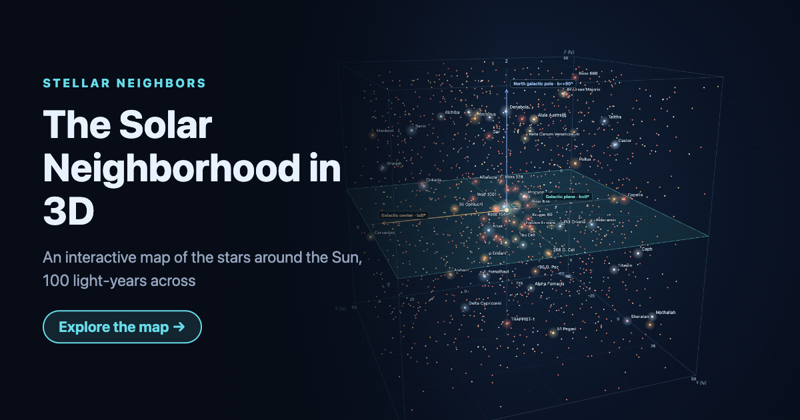

<div align="center">

# Stellar Neighbors

**A 3D map of the stars around the Sun, in a cube 100 light-years across,<br>that you can rotate, zoom and view from another star.**

[](https://github.com/ryochin/stellar-neighbors/actions/workflows/ci.yml)
[](LICENSE)

**[Open the map →](https://stellar-neighbors.aquahill.net/)**

<a href="https://stellar-neighbors.aquahill.net/"></a>

</div>

---

Stellar Neighbors places about 1,600 nearby stars at their real 3D positions in galactic coordinates, with the Sun at the center of the cube. Drag to turn it, zoom in on a crowded corner, and pick any star to see how far it is and what it is. Double-click a star and the whole map moves there, so you can see the neighborhood from Sirius or Proxima Centauri instead of from the Sun.

It is a static web app with no runtime libraries: the map is drawn with Canvas 2D, and everything runs in the browser.

## Contents

- [Features](#features)
- [Data](#data)
- [Development](#development)
- [Rebuilding the data](#rebuilding-the-data)
- [Deployment](#deployment)
- [Recording a promo clip](#recording-a-promo-clip)
- [License](#license)

## Features

### 🌌 The solar neighborhood in 3D

The cube is drawn in **galactic coordinates**: the XY plane is the galactic plane (b = 0°), the X axis points to the galactic center and the Z axis to the north galactic pole. Star colors follow their spectral types. Labels can show the major stars, all stars or none, and fade in and out as you turn the map. The **celestial equator** (J2000, δ = 0°) and the north celestial pole can be laid over the same stars, which shows how the familiar sky is tilted about 63° against the galaxy.

### 🔭 Observe from another star

Select a star and press **Observe from this star**, or simply double-click it, and the cube slides over so that star becomes the origin. Distances and the star list are then measured from the new observer, while the axes keep their orientation. Buttons for **Sirius** and **Proxima Centauri** and a **Back to the Sun** button are one click away. Any star within about 87 ly of the Sun can be an observer; the catalog reaches about 173 ly, so stars beyond the original cube still fill in around it.

This is a geometric comparison of distances. It does not account for light travel time, proper motion or how bright the sky would really look from there.

### 🔎 Find and inspect stars

Search by proper name, Bayer or Flamsteed designation, or catalog ID (HIP, HD, Gliese and others); the list is sorted by distance from the current observer. A star's details show its distance, galactic longitude and latitude, right ascension and declination, spectral type, other designations, apparent magnitude from Earth, and a link to its **Wikipedia** article when there is one.

### 🧭 Getting around

- **Mouse**: drag to rotate, wheel to zoom, click a star for details, double-click to observe from it.
- **Touch**: drag to rotate, pinch to zoom, tap for details, double-tap to observe. On phones the details open in a bottom sheet, and the map fits a phone held sideways.
- **Keyboard**: `R` resets the view and returns to the Sun, `T` looks straight down on the galactic plane.
- **Units**: switch distances between light-years, parsecs and mega astronomical units.
- **Max distance**: a slider limits how far from the observer stars are shown.

### 🌐 English and Japanese

The UI follows the browser's language, and `?lang=ja` or `?lang=en` in the URL picks one explicitly. The Japanese UI also uses Japanese names for the major stars and links to Japanese Wikipedia articles where they exist.

## Data

- **Positions, distances and magnitudes**: [HYG Database v4.1](https://github.com/astronexus/HYG-Database) by David Nash (CC BY-SA 4.0), filtered to stars within about 173 ly of the Sun (about 9,600 entries).
- **Japanese star names**: a hand-written table in `data-src/names/ja.json`, plus a few curated corrections in `data-src/curated-stars.json`.
- **Wikipedia links**: matched to the catalog stars through [Wikidata](https://www.wikidata.org/).
- **Galactic coordinate transform**: the ICRS-to-galactic rotation from [ESA Gaia DR3](https://gea.esac.esa.int/archive/documentation/GDR3/Data_processing/chap_cu3ast/sec_cu3ast_intro/ssec_cu3ast_intro_tansforms.html).

HYG does not include every star, so stars missing from it are missing from the map too. Star sizes on the map are schematic.

## Development

Requires Node.js 22 or later.

```bash
git clone https://github.com/ryochin/stellar-neighbors.git
cd stellar-neighbors
npm install

npm run dev       # Start the dev server at http://localhost:5173
npm run dev:lan   # Same, reachable from phones on the LAN
npm test          # Run the tests (Vitest)
npm run lint      # ESLint
npm run build     # Type-check and build into dist/
npm run preview   # Serve the built dist/
```

## Rebuilding the data

The generated files under `src/catalog/data/` are committed, so this is only needed when the source data or the build scripts change.

```bash
npm run build:catalog     # Download HYG (pinned commit, cached in data-src/cache/) and write stars.json and names.*.json
npm run build:wikipedia   # Query Wikidata and write wikipedia.*.json; rerun after build:catalog when star ids change
```

## Deployment

`npm run deploy` builds the site and syncs `dist/` to an S3-compatible bucket (AWS S3, Cloudflare R2 and others) with the AWS CLI. Hashed assets are cached forever, while `index.html` is revalidated on every request. Copy `.env.example` to `.env` and set the bucket:

| Variable                     | Purpose                                                                         |
| ---------------------------- | ------------------------------------------------------------------------------- |
| `S3_BUCKET`                  | Destination, e.g. `s3://my-bucket` or a prefix in it. The sync uses `--delete`. |
| `S3_ENDPOINT_URL`            | Endpoint for non-AWS services; leave empty for AWS S3                           |
| `AWS_PROFILE` / `AWS_REGION` | Optional AWS CLI settings (`auto` for R2)                                       |
| `DRY_RUN`                    | `1` shows what would be uploaded without uploading                              |

`DRY_RUN=1 npm run deploy` on the command line always wins over `.env`.

## Recording a promo clip

`npm run record:promo` records an 8-second clip for social posts into `video/promo.mp4` (1280 × 720, 30 fps, H.264). It rotates and zooms the map, then moves the observer to Sirius. The script drives the app in the installed Google Chrome through `playwright-core` on a paused clock, one frame at a time, so the motion is smooth regardless of machine load. It needs Google Chrome and `ffmpeg`; set `FFMPEG` to use another ffmpeg binary.

## License

The code is released under the MIT License — see [`LICENSE`](LICENSE).

The star data derived from the HYG Database (`src/catalog/data/stars.json` and the files built from it) is licensed under [CC BY-SA 4.0](https://creativecommons.org/licenses/by-sa/4.0/), like its source.
